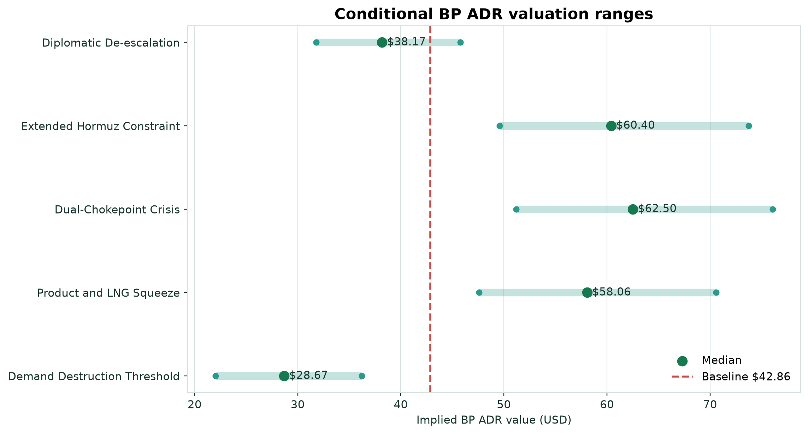
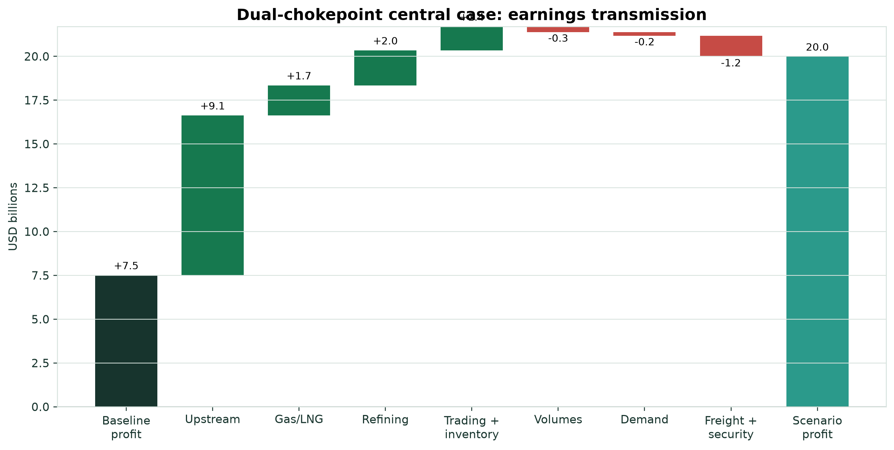
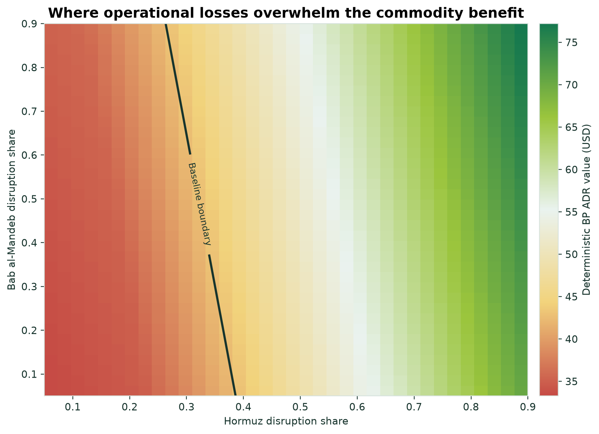
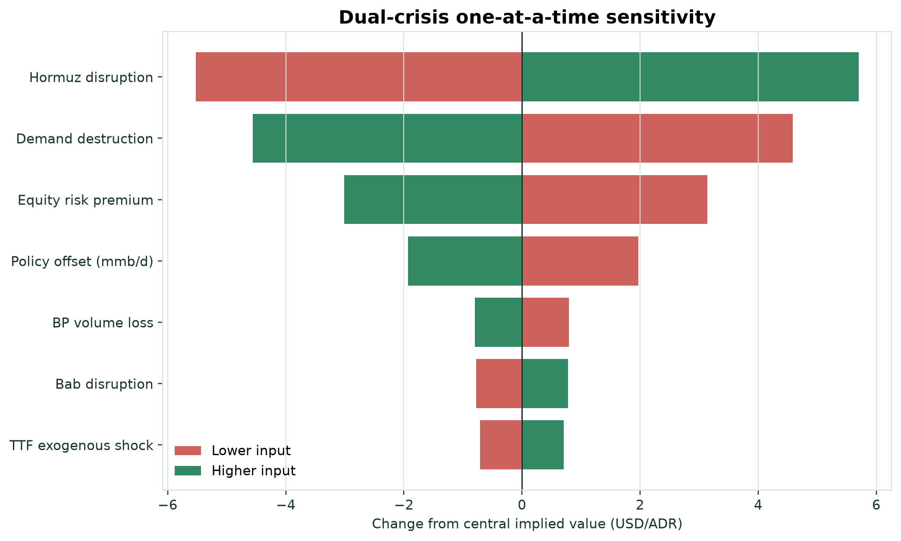

# BP Dual-Chokepoint Energy Shock Equity Stress Model


## Overview

This project estimates how a compound disruption affecting the **Strait of
Hormuz** and **Bab al-Mandeb** could transmit through energy markets, BP's
operations, and the market value of BP's U.S.-listed ADR.

It asks a deliberately nonlinear question:

> When does BP's benefit from higher oil, gas, and refining prices become
> overwhelmed by volume loss, logistics costs, working capital, demand
> destruction, net-debt pressure, and valuation-multiple compression?

The model is a transparent research stress test. It is not BP's internal
planning model, an event forecast, or investment advice.

## Headline findings

Pinned market baseline: **July 27, 2026** | **BP ADR $42.86** |
**Brent $90.93/bbl**

| Conditional scenario | Brent median | BP ADR P10 | Median | P90 | Probability above baseline |
|---|---:|---:|---:|---:|---:|
| Diplomatic De-escalation | $82 | $31.80 | **$38.17** | $45.78 | 20.8% |
| Extended Hormuz Constraint | $126 | $49.60 | **$60.40** | $73.74 | 98.6% |
| Dual-Chokepoint Crisis | $139 | $51.21 | **$62.50** | $76.07 | 99.2% |
| Product and LNG Squeeze | $117 | $47.60 | **$58.06** | $70.60 | 97.5% |
| Demand Destruction Threshold | $81 | $22.01 | **$28.67** | $36.22 | 1.1% |

These are **conditional distributions**. A 99.2% result means that 99.2% of
draws finish above the baseline *if the Dual-Chokepoint Crisis assumptions
hold*. It does not mean there is a 99.2% chance that the crisis will happen.



## Why BP is different

The framework follows the four-layer structure of the earlier XOM Compound Oil
Shock Equity Stress Model, but it is not a ticker substitution.

BP requires separate treatment of:

- international gas and LNG price transmission;
- refining, customer, and trading optionality;
- Red Sea freight and cargo-routing exposure;
- a higher modeled oil sensitivity than Exxon in the companion firm-level
  energy study;
- net debt and working-capital requirements;
- GBP/USD transmission into the U.S.-listed ADR.

## Four-layer architecture

### 1. Physical supply

The model combines:

- gross Hormuz oil disruption;
- effective Bab al-Mandeb losses after rerouting;
- Russian and Black Sea product losses;
- Saudi and UAE bypass capacity;
- policy offsets; and
- modeled demand response.

### 2. Energy markets

The net supply gap feeds a convex short-run Brent function. Separate channels
estimate:

- Brent crude;
- a TTF gas/LNG reference price;
- a composite refining crack spread; and
- a freight and security-cost index.

### 3. BP corporate transmission

Market changes flow through:

- upstream liquids earnings;
- gas and LNG earnings;
- refining margins;
- bounded trading and inventory effects;
- BP volume loss;
- customer demand destruction;
- freight and security costs;
- working capital; and
- net debt.

Trading effects are explicitly bounded because public reporting cannot reveal
BP's internal positions or cargo book.

### 4. ADR valuation

The implied ADR value is an ensemble of:

1. earnings scaling;
2. free-cash-flow scaling; and
3. a market-factor model.

The ensemble includes risk-premium, net-debt, market-return, GBP/USD, and
model-form uncertainty. Each scenario uses **10,000 Monte Carlo draws**.



## Threshold logic

The most important result is not the highest price target. It is the boundary
where additional disruption stops helping BP shareholders.



The boundary is conditional on the dual-crisis reference assumptions, including
9% demand destruction and a 12% equity-risk premium. Hormuz severity is the
largest one-at-a-time driver. Demand destruction and risk-premium expansion
work in the opposite direction.



## Repository structure

```text
.
├── config/
│   └── model_config.yaml
├── data/input/
│   ├── baseline_snapshot.csv
│   ├── scenarios.csv
│   └── source_register.csv
├── docs/
│   └── linkedin_post.md
├── outputs/
│   ├── charts/
│   ├── pdf/
│   ├── tables/
│   ├── executive_summary.md
│   └── run_manifest.json
├── src/bp_stress_model/
├── tests/
├── main.py
├── methodology.md
└── requirements.txt
```

## Quick start

### Windows PowerShell

```powershell
py -m venv .venv
.\.venv\Scripts\Activate.ps1
python -m pip install -r requirements.txt
python main.py
```

### macOS or Linux

```bash
python3 -m venv .venv
source .venv/bin/activate
python -m pip install -r requirements.txt
python main.py
```

The default run uses a pinned baseline so published results remain
reproducible.

To attempt a current BP ADR and Brent refresh:

```bash
python main.py --live
```

If the live request fails, the pipeline records the failure and safely returns
to the pinned baseline.

To change the draw count or seed:

```bash
python main.py --draws 20000 --seed 20260727
```

## Validation

Run the invariant and regression tests:

```bash
python -m unittest discover -s tests -v
```

The pipeline also writes a run manifest that checks:

- P10 <= median <= P90;
- conditional probabilities remain between zero and one;
- numeric outputs are finite; and
- model version, seed, draw count, and baseline status are recorded.

## Primary sources

- [BP 4Q and FY 2025 results](https://www.bp.com/press-and-publications/press-releases/fourth-quarter-2025-results)
- [BP Q1 2026 results](https://www.bp.com/press-and-publications/press-releases/first-quarter-2026-results)
- [BP Annual Report and Form 20-F 2025](https://www.bp.com/investors/results-reporting-and-presentations/annual-report)
- [U.S. EIA: Strait of Hormuz](https://www.eia.gov/todayinenergy/detail.php?id=65504)
- [U.S. EIA: LNG disruption](https://www.eia.gov/todayinenergy/detail.php?id=67604)
- [U.S. EIA: Red Sea shipping](https://www.eia.gov/todayinenergy/detail.php?id=61363)
- [Reuters: July 27, 2026 oil-market update](https://www.reuters.com/business/energy/oil-slips-more-than-5-after-us-pauses-strikes-iran-2026-07-26/)
- [FRED: Brent crude oil](https://fred.stlouisfed.org/series/DCOILBRENTEU)

The full source register, dates, data points, and model roles are available in
[`data/input/source_register.csv`](data/input/source_register.csv).

## Limitations

- Scenario occurrence probabilities are intentionally not estimated.
- Public data cannot reproduce BP's trading positions, hedges, taxes, cargo
  exposures, or internal plans.
- TTF and composite crack-spread baselines are modeled references rather than
  live licensed price feeds.
- The market transmits shocks faster than company filings can validate them.
- Results are sensitive to elasticities, capture rates, demand destruction,
  market returns, and valuation compression.
- The model should be recalibrated as new filings and event data arrive.

## Author

**Jason Keen**  
Finance graduate student and independent risk-intelligence researcher

